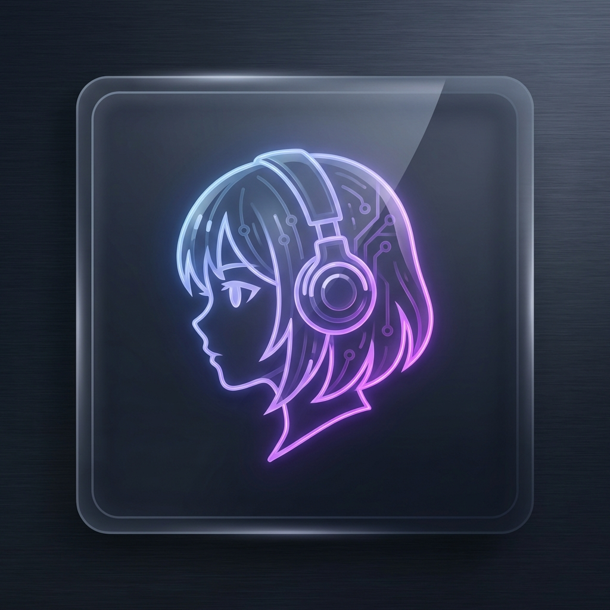

<p align="center">
  
</p>

<h1 align="center">VTuber App</h1>

<p align="center">
  <strong>AI-Powered Virtual Character Desktop Application</strong>
</p>

<p align="center">
  
  
  
  
</p>

<p align="center">
  
  
  
  
</p>

---

## ✨ Features

### 🎭 Character Support
- **Live2D Hub**: Generic support for Live2D Cubism 4 models.
- **MMD Ready (Roadmap)**: Future support for PMX/VMD (MikuMikuDance) formats.
- **Natural Animations**: Breathing, blinking, and gaze tracking.
- **Lip-Sync**: Synchronized with AI-generated speech (TTS).
- **Format Independent**: Built to load user-provided assets securely.

### 🧠 AI-Powered Conversation
- **Multi-provider support**: Groq, Gemini, DeepSeek, OpenAI, Mistral
- **Long-term memory**: LanceDB vector database with Mistral embeddings
- **RAG-enhanced responses**: Context-aware conversations
- **Background labeling**: Auto-categorize memories by emotion/topic

### 🔊 Voice Services
- **TTS**: Edge TTS with multiple voice profiles
- **STT**: Groq Whisper for speech recognition
- **Voice cloning ready**: GPT-SoVITS integration prepared

### 🎮 Modern Launcher
- Beautiful game-style launcher UI
- Auto-update system with signed bundles
- Background carousel with news feed
- Settings integration

### 🔐 Security
- **Asset Encryption**: AES-256-GCM with hardware-derived keys
- **Update Signing**: Ed25519 digital signatures
- **Delta Patching**: HDiffPatch for bandwidth-efficient updates

---

## 🖼️ Screenshots

<p align="center">
  <i>Coming soon...</i>
</p>

---

## 🚀 Quick Start

### Prerequisites
- Node.js 18+
- Rust 1.75+
- Windows 10/11 (primary target)

### Installation

```bash
# Clone the repository
git clone https://github.com/NestiaDev-id/Vtuber-App.git
cd Vtuber-App

# Install dependencies
npm install

# Configure environment
cp .env.example .env
# Edit .env with your API keys

# Run in development mode
npm run tauri dev
```

### Building for Production

```powershell
# Build with signing (requires .env with signing keys)
.\build.ps1
```

---

## ⚙️ Configuration

Create a `.env` file based on `.env.example`:

```env
# AI Providers
VITE_GROQ_API_KEY=your_groq_key
VITE_GEMINI_API_KEY=your_gemini_key
VITE_MISTRAL_API_KEY=your_mistral_key
VITE_DEEPSEEK_API_KEY=your_deepseek_key
VITE_OPENAI_API_KEY=your_openai_key

# Signing (for release builds)
TAURI_SIGNING_PRIVATE_KEY=your_base64_key
TAURI_SIGNING_PRIVATE_KEY_PASSWORD=your_password

# Asset Encryption
APP_ASSET_SALT=your_secret_salt
```

---

## 🗂️ Project Structure

```
vtuber-app/
├── src/                    # Frontend (React + TypeScript)
│   ├── components/         # UI Components
│   │   ├── launcher/       # Launcher UI (Carousel, Sidebar, ActionPanel)
│   │   ├── VTuberCharacter.tsx
│   │   ├── ControlPanel.tsx
│   │   └── SettingsModal.tsx
│   ├── api.ts              # Tauri backend API calls
│   ├── types.ts            # TypeScript interfaces
│   └── App.tsx             # Main application
├── src-tauri/              # Backend (Rust)
│   ├── src/
│   │   ├── commands/       # Tauri commands
│   │   │   ├── llm.rs      # AI provider integrations
│   │   │   ├── memory.rs   # LanceDB operations
│   │   │   ├── audio.rs    # TTS/STT handling
│   │   │   └── updater.rs  # Update system
│   │   ├── updater/        # Asset management
│   │   │   ├── encryption.rs
│   │   │   ├── downloader.rs
│   │   │   └── patcher.rs
│   │   └── lib.rs          # Main entry point
│   └── tauri.conf.json     # Tauri configuration
├── release/                # Release artifacts
│   ├── latest.json         # Updater manifest
│   └── manifest.json       # Asset manifest
├── tools/                  # Developer tools
│   └── encrypt_assets.rs   # Asset encryption CLI
└── build.ps1               # Release build script
```

---

## 🔧 Tech Stack

| Layer | Technology |
|-------|------------|
| **Desktop Framework** | Tauri 2.0 |
| **Frontend** | React 18, TypeScript, Tailwind CSS |
| **Backend** | Rust |
| **Live2D** | pixi.js + pixi-live2d-display |
| **Vector Database** | LanceDB |
| **Encryption** | AES-256-GCM (aes-gcm crate) |
| **Compression** | Zstandard |
| **Delta Updates** | HDiffPatch |

---

## 📦 Release Process

1. **Build**: `.\build.ps1`
2. **Sign**: Automatic (uses `.env` signing keys)
3. **Upload to GitHub Release**:
   - `vtuber-app_x.x.x_x64_en-US.msi`
   - `release/latest.json`

See [release/README.md](release/README.md) for detailed instructions.

---

## 🛣️ Roadmap

- [x] Live2D character integration
- [x] Multi-provider AI chat
- [x] Long-term memory (RAG)
- [x] Auto-update system
- [x] Asset encryption
- [ ] MMD (MikuMikuDance) PMX/VMD Support
- [ ] Voice cloning (GPT-SoVITS)
- [ ] Multi-language support
- [ ] Linux/macOS builds
- [ ] Plugin system

---

## 🎨 Credits & Character Handling

This application is designed as a character-agnostic platform. It provides the framework to load and animate virtual characters:

- **Live2D**: Compatible with Live2D Cubism 4 models. Sample models used during development are properties of **Live2D Inc.** (Artwork by Kani Biimu).
- **MMD**: Support for PMX/VMD formats is under development.
- **Assets**: Character models are not bundled within this repository to respect intellectual property rights. Users should provide their own licensed assets in the character directory.

---

## 📄 License

MIT License - see [LICENSE](LICENSE) for details.

---

<p align="center">
  <strong>Built with ❤️ by <a href="https://github.com/NestiaDev-id">NestiaDev</a></strong>
</p>

<p align="center">
  <a href="https://github.com/NestiaDev-id/Vtuber-App/issues">Report Bug</a> •
  <a href="https://github.com/NestiaDev-id/Vtuber-App/issues">Request Feature</a>
</p>
